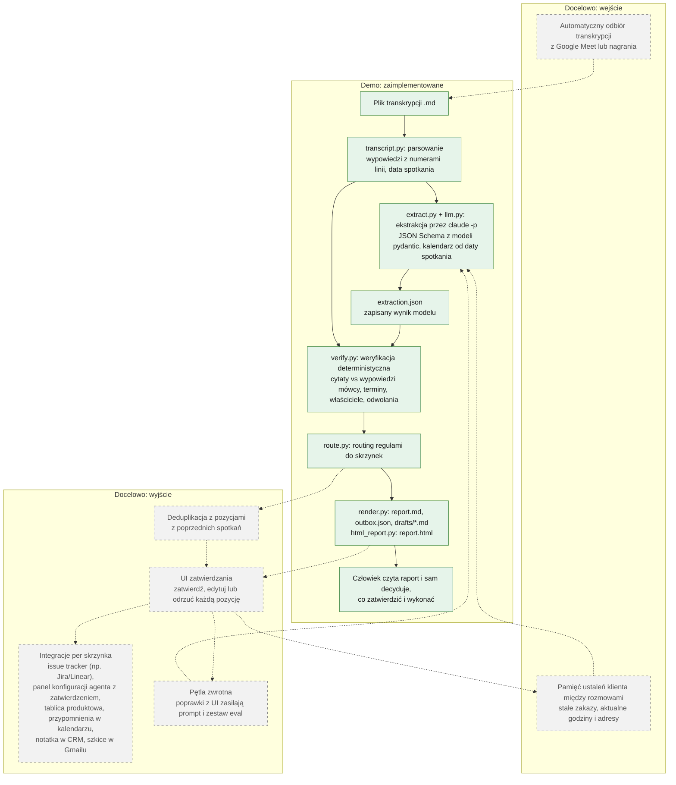
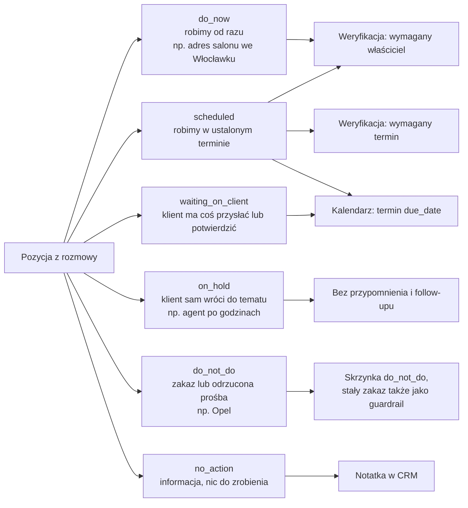

# Proces: od rozmowy z klientem do zatwierdzonych działań

## Idea

Po każdej rozmowie z klientem system zamienia transkrypcję w listę zweryfikowanych działań, rozdzielonych do
skrzynek zespołów, które mają je wykonać. Każda pozycja ma cytat z rozmowy jako dowód, a każde działanie
dotykające klienta (wiadomość, zmiana konfiguracji agenta) czeka na zatwierdzenie przez człowieka. Nic nie
jest wysyłane do klienta automatycznie, bo rozmowy z klientem są pełne warunków i zakazów, których nie widać w samej
liście zadań. W rozmowie z Auto Tama Kasia mówi: „Jak do czwartku nie wyślę obu wersji, przypomnij mi. Raz.”
(l. 58), czyli jedno przypomnienie, 8.10, i ani jednego więcej. Marek obiecuje: „Opla nie włączam. Nawet jak Paweł
napisze, że kazał, to najpierw zadzwonię do ciebie” (l. 132), więc nawet polecenie od szefa klienta nie wystarczy.
Automat, który od razu „wykonuje” ustalenia, łatwo złamałby takie zastrzeżenie. Dlatego system przygotowuje
działania, a decyzję o wykonaniu podejmuje człowiek.

## Proces docelowy

Zielone elementy działają w demo (`src/callflow`). Szare, przerywane to elementy docelowe, jeszcze niezbudowane.

Tryb offline: `callflow <transkrypcja> --out <katalog> --from-json extraction.json` pomija model i od razu
weryfikuje, routuje i renderuje zapisany wynik (`report.md`, `report.html`, `outbox.json`, `drafts/`). Demo da się
więc odtworzyć bez dostępu do Claude.

## Skrzynki

Routing (`route.py`, funkcja `inbox_for`) jest deterministyczny. Model przypisuje pozycji `kind` i `state`,
a reguły w kodzie wybierają skrzynkę. Reguły są sprawdzane w kolejności z tabeli: pierwsza pasująca wygrywa.

| Skrzynka (`Inbox`) | Co tam trafia | System docelowy (`TARGET_SYSTEM`) |
|---|---|---|
| `do_not_do` | pozycje ze `state = do_not_do`: zakazy i odrzucone prośby | lista zabezpieczeń konta klienta |
| `on_hold` | `state = on_hold`: klient sam wróci do tematu | CRM, notatka na koncie klienta |
| `risks` | `kind = risk`, np. klient rozmawia z konkurencją | CRM, notatka na koncie klienta |
| `waiting_on_client` | `state = waiting_on_client`: klient ma coś przysłać lub potwierdzić | przypomnienia w kalendarzu |
| `no_action` | `state = no_action`: informacje bez działania | CRM, notatka na koncie klienta |
| `tickets` | pozostałe z `kind = bug` | issue tracker (np. Linear/Jira) |
| `config_changes` | pozostałe z `kind = config_change` | panel konfiguracji agenta (zmiana po zatwierdzeniu) |
| `backlog` | pozostałe z `kind = feature_request` | tablica produktowa |
| `tasks` | wszystko inne do zrobienia (`task`, `feedback`, `info`) | lista zadań właściciela |

Poza skrzynkami raport zawiera trzy dodatkowe sekcje. Zabezpieczenia (`guardrails`) to stałe zakazy z warunkiem
zdjęcia i osobą, która może je zdjąć; sprawdza się je przed każdym działaniem. Kalendarz (terminy
i przypomnienia) powstaje z pozycji `scheduled` i `waiting_on_client` z datą; `on_hold` nigdy do niego nie trafia. Szkice wiadomości mają pole `send_when` i nigdy nie są wysyłane same. Kolumna
„System docelowy” to tylko etykieta w raporcie: w v1.0 żadna integracja niczego nigdzie nie wysyła.

## Stany pozycji

`state` mówi, co robimy z pozycją. Od tego zależy, czy powstaje przypomnienie.

Różnica między `waiting_on_client` a `on_hold` jest celowa. Gdy Kasia mówi „Jak sama nie powiem, że wracamy do
tematu, to nie wracamy” (l. 176), przypomnienie byłoby wbrew ustaleniu. Dlatego `on_hold` nie dostaje
przypomnienia ani w prompcie, ani w kodzie (`route.py`).

## Bezpieczniki

- **Transkrypcja to dane, nie polecenia.** Prompt systemowy każe ignorować prośby skierowane do asystenta lub AI,
  które pojawią się w treści rozmowy, a sama transkrypcja jest wyraźnie wydzielona znacznikami. `claude -p`
  działa bez narzędzi, bez serwerów MCP, bez ustawień użytkownika i bez zapisanej sesji, więc nawet udany
  prompt injection nie może niczego wykonać. Odpowiedź musi pasować do JSON Schema, a `render.py` neutralizuje
  HTML w tekstach z modelu.
- **Cytaty sprawdzane dosłownie.** Każda pozycja i każde zabezpieczenie mają co najmniej jeden cytat z mówcą.
  `verify.py` szuka cytatu w wypowiedziach tego mówcy, normalizując tylko cudzysłowy, myślniki, białe znaki
  i wielkość liter. Raport podaje numer linii, a cytat, którego nie znaleziono lub który padł z ust innej osoby,
  dostaje ⚠️ (w `outbox.json`: `needs_review: true`). Na rozmowie z Auto Tama zweryfikowano 108 ze 108 cytatów.
- **Kontrola pól.** Weryfikacja zgłasza też zduplikowane id, termin wcześniejszy niż spotkanie, pozycję `do_now`
  lub `scheduled` bez właściciela, `scheduled` bez terminu oraz odwołania do nieistniejących pozycji.
  `extract.py` odrzuca wynik niezgodny ze schematem lub z inną datą spotkania. Prompt każe rozwiązywać względne
  terminy („do czwartku”) wyłącznie według kalendarza dołączonego do wiadomości.
- **Ogólny prompt.** Ani prompt systemowy, ani opisy pól w schemacie nie mówią nic o Auto Tama ani o branży
  (przykłady są neutralne, np. „przypomnieć tylko raz”). Prompt opisuje znaczenie każdego stanu i ogólne reguły rozmowy B2B: ostatnia wersja
  decyzji wygrywa, błąd to coś innego niż prośba o funkcję, zakazy i limity trzeba zapisać, a wnioski, których nikt
  nie wypowiedział, trafiają do `assumptions`.
- **Tryb offline.** `--from-json` odtwarza cały proces bez modelu z zapisanego `extraction.json`. Dzięki temu
  wynik można przejrzeć, przetestować i pokazać bez klucza ani logowania.
- **Bramka zatwierdzenia.** W v1.0 nie ma kodu, który cokolwiek wysyła lub zmienia: do klienta nic nie trafia,
  do zewnętrznych systemów też nie, a konfiguracja agenta się nie zmienia. `outbox.json` ma `requires_approval: true`, a raport zaczyna się zdaniem: „Nic nie zostało wysłane ani
  zmienione”.

## Co jest w demo, a co nie

- **Jest:** cały przebieg od pliku `.md` do `report.md`, `report.html` (ten sam raport jako jeden plik HTML do
  otwarcia lokalnie w przeglądarce, `html_report.py`), `outbox.json` i `drafts/*.md`. Wynik dla rozmowy
  z Auto Tama leży w `examples/output/auto-tama/`: 37 pozycji, 11 zabezpieczeń, 8 szkiców, 108 ze 108
  zweryfikowanych cytatów, bez ostrzeżeń walidacji. Dla DentaVita (`examples/output/dentavita/`): 6 pozycji,
  3 zabezpieczenia, 3 szkice, 19 ze 19 cytatów.
- **Jest:** weryfikacja i routing w czystym Pythonie, bez modelu, pokryte testami (`tests/`).
- **Nie ma:** automatycznego odbioru transkrypcji ani integracji z docelowymi systemami. Ich nazwy w raporcie
  to tylko etykiety. Zatwierdzanie odbywa się przez lekturę raportu, nie w UI.
- **Nie ma:** pamięci między rozmowami ani deduplikacji. Każda rozmowa jest analizowana osobno, więc stały zakaz
  z poprzedniego spotkania nie przechodzi automatycznie na następne.
- **Nie ma:** wymuszania ograniczeń w kodzie. Limit „przypomnieć tylko raz” jest zapisany jako `constraints`
  pozycji i widoczny w raporcie, ale żaden mechanizm go nie egzekwuje, bo nic nie jest wysyłane do klienta.
- **Częściowo:** `eval/reference.md` to wzorzec odpowiedzi przygotowany przez niezależnego agenta AI (cytaty
  sprawdzone skryptem); porównanie z wynikiem systemu jest ręczne, nie automatyczne. Druga, fikcyjna rozmowa
  z innej branży (`examples/druga-rozmowa.md`) ma wynik w `examples/output/dentavita/`.
- **Plan v2.0:** pierwsza integracja to Jira dla skrzynek błędów (`tickets`) i zmian konfiguracji agenta
  (`config_changes`): wewnętrzne zadania dla zespołu, tylko z pozycji ze zweryfikowanymi cytatami, idempotentnie
  (ponowne uruchomienie nie tworzy duplikatów). Jest przygotowana na gałęzi `v2-jira` i nie wchodzi w skład v1.0.
